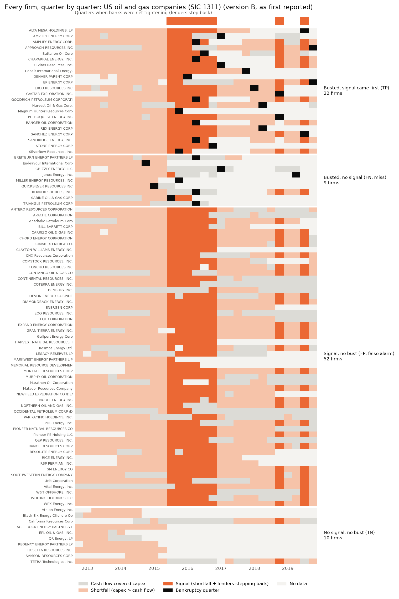

# The Funding-Gap Hypothesis

*Andrew Razo · a small, pre-registered, reproducible pilot study*

## The question

> **The Funding-Gap Rule:** *A building boom ends in a bust when builders' cash flow falls
> short of their spending and lenders step back.*

This borrows from Ray Dalio's idea that bubbles usually burst when holders must sell
assets to raise cash (reported by Forbes, Oct 7, 2026). Applying it to **builders**,
measured through the gap between their spending and cash flow, is **my own extension**.
The method follows Dalio's essay "Principled Thinking and AI Need to Go Together"
(June 10, 2026): write the principle down from cause-and-effect logic, then test it
against history rather than mining history for what worked. Sources are in
[RULE.md](RULE.md).

## The answer, briefly

**In this pilot the rule failed.** Among 93 SEC-registered oil and gas companies
(2013–2019), firms that showed the signal went bankrupt *less* often than firms that
didn't: 30% vs 47%, p = 0.18, n = 93. The main reason: almost every producer outspent its
cash flow in 2013–15, and the bank-tightening measure turned on for everyone at once in
2015, so the signal couldn't separate failures from survivors. A pre-registered,
mechanically chosen comparison boom (computer services, SIC 7370, 2011–14) had no
bankruptcies, and the signal fired for 2 of its 15 firms. Full results, the confusion
tables, every variant and the limits are in **[RESULTS.md](RESULTS.md)**.

**Follow-up (RESULTS.md section 9):** measuring "lenders step back" from each firm's *own*
bank credit cuts, read from 48,873 filing sentences, changes the picture. Firms whose own
lenders cut them went bankrupt far more often (49% vs 14% with the full rule; 47% vs 9% for
the cut alone). But the overspending condition adds nothing beyond the bank's cut, the
measure is noisy, and the pattern is predictive, not causal.



## Definitions (full, code-ready versions in [RULE.md](RULE.md))

| Term | Definition |
|---|---|
| Shortfall | Trailing-four-quarter capex > trailing-four-quarter operating cash flow |
| Lenders step back | Fed Senior Loan Officer Survey, FRED `DRTSCILM` > 0 (more banks tightening than easing); side check: Moody's Baa spread above its 5-year median |
| Signal | Shortfall **and** lenders stepping back in the same quarter |
| Bust (B1, primary) | 8-K filed under Item 1.03 "Bankruptcy or Receivership" |
| Bust (B2, secondary) | B1, or trailing capex falls to half its prior-3-year peak |
| Hit (TP) | Bust with a signal in the 12 quarters before it |
| False alarm (FP) | Signal in 2013–2016, no bust through 2019 |

## Data sources

| Source | What | Where |
|---|---|---|
| SEC EDGAR XBRL `companyfacts` | Operating cash flow, capex (tag map per company) | `data.sec.gov/api/xbrl/companyfacts/` |
| SEC EDGAR XBRL `frames` | Every filer's total assets at 2013 year end (the universe) | `data.sec.gov/api/xbrl/frames/` |
| SEC EDGAR company list by SIC | Companies under SIC 1311 | `sec.gov/cgi-bin/browse-edgar` |
| SEC EDGAR `submissions` | 8-K item numbers (bankruptcy = Item 1.03) | `data.sec.gov/submissions/` |
| FRED `DRTSCILM` | Bank lending standards survey | fred.stlouisfed.org/series/DRTSCILM |
| FRED `BAA10Y` (side check) | Moody's Baa spread (**not redistributed**; flag only) | fred.stlouisfed.org/series/BAA10Y |
| FRED `DCOILWTICO` (context only) | WTI oil price | fred.stlouisfed.org/series/DCOILWTICO |

Every download is logged in `data/raw/SOURCES.csv` with URL, time and SHA-256. Every
company value carries its filing accession number and an EDGAR link. Nothing is
estimated or filled in: missing stays missing.

## Method in five steps

1. **Pre-register** ([RULE.md](RULE.md)), committed before any data was downloaded.
2. **Pick the sample mechanically:** SIC 1311 × assets ≥ $500M at 2013 year end. That
   gives 101 firms; 94 have enough data (93 after dropping a duplicate parent/subsidiary filer). Because the source still lists companies
   that later failed or were acquired, the sample isn't limited to survivors.
3. **Build cash-flow series** from XBRL. Year-to-date figures are differenced, and the
   trailing-twelve-month identity (each year-to-date comparison inside one 10-Q) is used where firms re-tag lines between filings
   ([LEARN.md](LEARN.md) §3–4). The tag map and these tables were committed **before**
   any bankruptcy data was downloaded.
4. **Label busts** from 8-K Item 1.03 and run the pre-registered 2×2 test.
5. **Report everything:** the headline, the method as pre-registered (Version A), and all
   32 variants.

## Limitations (more in [RESULTS.md](RESULTS.md) §5)

- One industry, one episode, 93 firms: a pilot, not proof.
- The lender measure is economy-wide, so it can't vary across firms.
- The oil-price collapse caused both shortfalls and bankruptcies (confounding).
- The bankruptcy measure misses firms that deregistered first and out-of-court defaults.
- The window ends in 2019 as pre-registered; seven firms with no bankruptcy by then (six of them false alarms) filed in 2020.
- One economy-wide survey and one oil shock drive everything, so firms are not independent and p-values overstate the evidence.
- An independent peer review found and corrected one mislabeled bankruptcy (RESULTS.md section 8).
- SIC 1311 includes a few non-producers.

## Stage 1 (descriptive only): five large tech spenders

Capex vs operating cash flow for Amazon, Microsoft, Alphabet, Meta and Oracle, 2015 to
2026Q3. As of 2026Q3, Oracle (1.61×) and Amazon (1.28×) spend more than their operating
cash flow; Alphabet, Meta and Microsoft don't. **This is not a prediction:** Stage 2
shows the same conditions also fit firms that survived.
Charts: `figures/stage1_*.png`.

## Rerun everything

```bash
python -m venv .venv
.venv/Scripts/pip install -r requirements.txt     # Mac/Linux: .venv/bin/pip
export SEC_USER_AGENT="Your Name your@email.com"  # required by the SEC
export FRED_API_KEY="..."                         # free: fred.stlouisfed.org
python run_all.py                                 # tests, Stage 1, Stage 2
```

Cached raw data in `data/raw/` is reused. Delete it to re-download from scratch. Note that
EDGAR keeps adding filings, so a fresh download includes later quarters, and "latest
filed" values may change.

## Repository map

```
RULE.md          pre-registration (definitions, test, failure conditions)
CHANGELOG.md     every change after pre-registration, with reasons
RESULTS.md       what the test showed and did not show
LEARN.md         every method and trap, in plain language
run_all.py       one command to reproduce everything
fundgap/         library: EDGAR/FRED access, YTD differencing, TTM, labels
stages/          stage1_hyperscalers.py, stage2a_universe_and_tags.py, stage2b_test.py,
                 stage2c_select_comparison.py (the comparison boom),
                 stage3a_borrowing_base.py, stage3b_test.py (firm-level lender follow-up)
tests/           unit tests (YTD differencing, TTM, labels, confusion table)
data/raw/        raw downloads (gzip) + SOURCES.csv
data/clean/      tables produced by the stages
data/*tag_map*   which XBRL tags were used for each company, and why
figures/         charts
```
