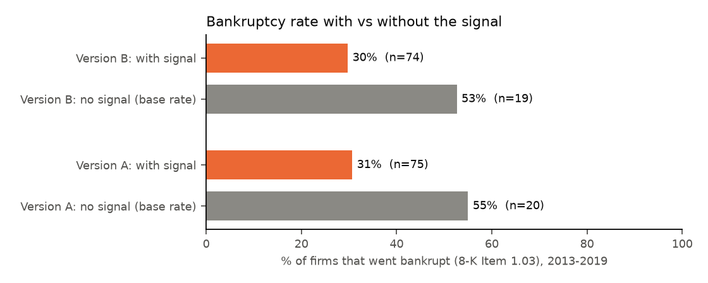
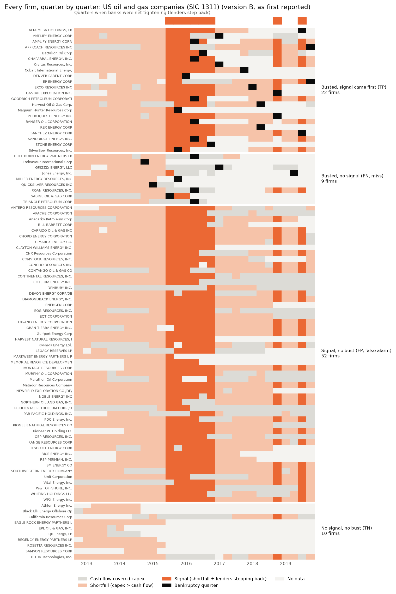
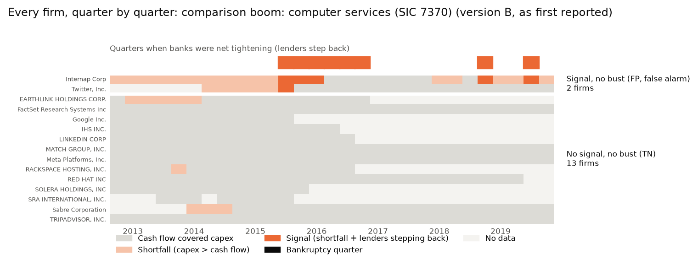
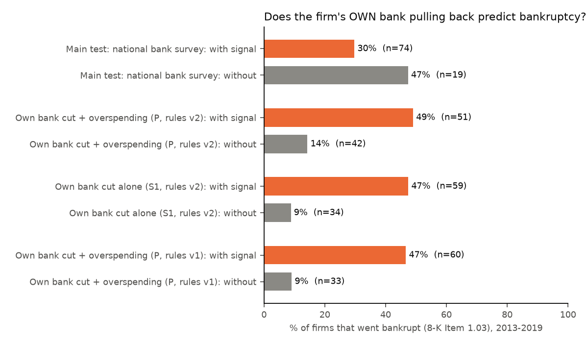
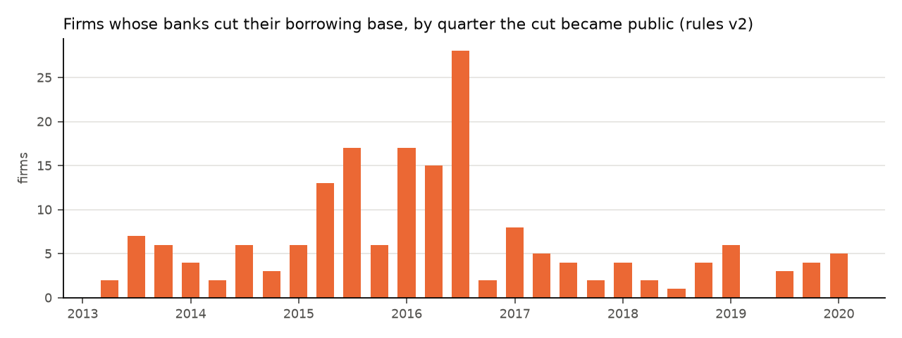

# RESULTS

**Short version:** In this pilot the rule **failed**. Among 93 SEC-registered oil and gas
companies from 2013 to 2019, firms that showed the warning signal went bankrupt *less*
often than firms that didn't: 30% vs 47%. The difference isn't statistically reliable
(p = 0.18), and the sample is small. The main reason is instructive: in 2013–2015 almost
every producer spent more than its operating cash flow, so when banks tightened in 2015
the signal lit up for nearly everyone and couldn't tell the firms that would fail from
the ones that would survive.

A pre-registered comparison boom (computer services, SIC 7370, chosen mechanically as
the fastest-growing non-energy capex boom of 2011–14) had no bankruptcies, and the
signal fired for only 2 of its 15 firms (section 6).

**Follow-up (section 9):** when "lenders step back" is measured from each firm's *own*
lenders (cuts to its borrowing base, read from its filings) instead of a national survey,
the signal becomes informative. Counting every cut the computer detected, 49% of signaled
firms went bankrupt vs 14% of the rest. But an audit that hand-checked every cut behind a
signal found about a third were not bank decisions (asset sales, transactions, required
paydowns). **Counting only verified bank cuts: 45% vs 25% (p = 0.047).** That's a real but
much weaker, borderline pattern. The overspending half of the rule adds nothing beyond the
bank's cut, and this is a predictive pattern, not proof of cause.

The study was peer-reviewed after the first results (section 8). One bankruptcy label
was a data error and was corrected, which moved the base rate from 53% to 47%. No check
changes the conclusion.

This is a small pilot, not proof. The test's numbers come from `data/clean/`, mainly
`stage2_results_all_variants.csv`, `stage2_labels_all_variants.csv` and
`stage2_posthoc_checks.csv`. Each firm's label traces to SEC filings by accession number.

---

## 1. The headline test (pre-registered settings)

Settings: Version B (corrected data handling, CHANGELOG v1.1). Bust = bankruptcy shown
by an 8-K under Item 1.03. Lenders step back = Fed survey `DRTSCILM` > 0. Values as first
reported. Firms that stopped filing count as "no bust."

|                    | Bankrupt 2013–2019 | Not bankrupt |
|--------------------|-------------------:|-------------:|
| **Signal**         | 22 (TP)            | 52 (FP)      |
| **No signal**      | 9 (FN)             | 10 (TN)      |

- **n = 93 firms**, of which 31 (33%) went bankrupt.
- **Bust rate with the signal: 22 / 74 = 30%.**
- **Base rate (bust rate without the signal): 9 / 19 = 47%.**
- Difference: −18 percentage points. Fisher's exact test, two-sided: p = 0.18.
- **False positives: 52.** All are named in the labels file. They include the largest
  producers in the sample (e.g. EOG, Pioneer, Devon, Occidental).
- **Strict reading (rule as a law): falsified.** 52 firms survived the signal and 9 went
  bankrupt without it.
- **Probabilistic reading: not supported.** The signal did not raise the bust rate above
  the base rate.

Before the peer-review correction (section 8) the headline was 22/74 = 30% vs
10/19 = 53%, p = 0.10, with the same reading. Version A, the method exactly as
pre-registered, gives the same answer: 23/75 = 31% vs 10/20 = 50%, p = 0.12, n = 95.
Version A's n is larger because it keeps Ultra Petroleum (a miss) and EP Energy LLC,
which counts EP Energy's bankruptcy twice.

## 2. Why it failed: the signal was almost universal

- **The shortfall was the norm, not the warning.** From 2013Q1 to 2015Q2, 87% of
  measurable firm-quarters had capex above operating cash flow (n = 856), and **91 of 93
  firms** had at least one such quarter. Outspending cash flow, and funding the gap with
  debt and equity, was how the shale boom worked for winners and losers alike.
- **The lender proxy flips for everyone at once.** `DRTSCILM` is one economy-wide number.
  It turned positive in 2015Q3, and **62 of the 74 signals first fired in that quarter.**
  At the firm level, "signal" mostly means "was still outspending cash flow in mid-2015."
- **Many no-signal firms never had a chance to signal.** Of the 19 no-signal firms, 12 have
  no measurable data in any quarter when lenders were stepping back:
  - 8 of the 10 true negatives stopped filing (most were acquired; EPL kept filing into 2016,
    but its XBRL data has no usable operating cash flow after 2014Q1);
  - 4 of the misses went bankrupt before or just as the survey turned positive, or
    stopped filing first.

  The comparison group is shaped by timing and data coverage, not just by finances.
  Dropping these firms is in section 8.

## 3. The misses (false negatives), with reasons

| Reason (12 quarters before the bust) | Firms |
|---|---|
| Lenders never stepped back in that window: bankrupt before the survey turned positive | 3: Endeavour 2014Q4, Quicksilver 2015Q1, Sabine 2015Q3 |
| Shortfall, but never while lenders were stepping back (spending already cut below cash flow) | 4: Linn Energy, Breitburn, Triangle, Vanguard |
| No data in the quarters when lenders were stepping back | 1: Miller Energy |
| No shortfall in that window | 1: Jones Energy (2019) |

Jones had a signal in 2015Q3, but that is more than 12 quarters before its 2019
bankruptcy, so under the pre-registered window it doesn't count.

Four misses had already cut capex below cash flow by the time banks tightened. That
pattern fits a story where **debt already taken on** matters more than the current
spending gap; this project doesn't measure debt. Triangle's bankruptcy filing was made by
its main operating subsidiary, not the parent. It counts under RULE.md's wording because
the parent reported it under Item 1.03.

## 4. Robustness: all 32 pre-specified variants

Full table: `data/clean/stage2_results_all_variants.csv`.

| Variation | Bust rate with signal vs. base rate | Reading |
|---|---|---|
| Headline (B, B1, DRTSCILM, first reported, exits kept) | 30% vs 47%, p = 0.18 | not supported |
| Version A, as pre-registered | 31% vs 50%, p = 0.12 | not supported |
| Latest-filed values instead of first-reported | identical to headline | not supported |
| Side-check lender proxy (BAA10Y) | 31% vs 42%, p = 0.42 | not supported |
| Firms that stopped filing dropped (n = 73) | 35% vs 82%, p = 0.007 | not supported; the signal goes the *wrong* way |
| Bust = bankruptcy **or** a 50% capex cut (B2) | 87% vs 92% | not supported: nearly everyone "busts" |
| B2 with BAA10Y | 91% vs 81%, p = 0.37 | mixed (higher, not significant) |

Across the 32 variants, **28 are "not supported" and 4 are "mixed"**. All 4 mixed ones are
B2 × BAA10Y; none favors the rule with p < 0.05. Every B1 variant with p < 0.05 goes the
wrong way and drops the firms that stopped filing, which leaves a tiny no-signal group.
The variants share most of their data, so they aren't 32 independent confirmations.

The B2 rows confirm the concern written into RULE.md before any data was pulled: in
2015–16 nearly every producer cut capex by half, so "bust = 50% capex cut" can't separate
anything.

## 5. What this does and does not show

**It shows:**
- At the **firm** level, in this industry and episode, "capex above cash flow while banks
  tighten" did not separate the producers that went bankrupt from the ones that survived.
- The rule's two conditions were close to universal in the 2015–16 oil bust. A rule that
  fires for almost everyone carries little information about *which* firm fails.

**It does not show:**
- That the rule is wrong about **booms as a whole.** At the industry level the episode
  partly fits the story: an industry-wide spending gap, banks tightening, a third of
  firms bankrupt. But the fit is loose. The oil collapse and the first bankruptcies
  (Endeavour, Quicksilver, Sabine) came *before* the bank survey turned positive. The
  same tightening also hit the computer-services boom, which had no bankruptcies. And
  either way it is one boom, not a test.
- Anything causal. WTI oil fell 75.7%, from $107.95 on 2014-06-20 to $26.19 on 2016-02-11
  (FRED `DCOILWTICO`, US EIA data). That cut cash flow (creating shortfalls) and caused
  bankruptcies at the same time, and this design can't separate the two.
- That the opposite is true. The "wrong-way" pattern (signaled firms busted less) comes
  from timing and coverage: early busts, early takeovers, and firms with no data while
  banks were tightening. It is not evidence that outspending is safe.

**Statistical caveat.** Fisher's exact test assumes each firm is an independent draw.
Here one economy-wide survey drives every firm's lender condition and one oil shock
drives most bankruptcies, so the firms are far from independent. **Every p-value in this
report overstates how much information the data carries**, including the small,
wrong-way ones.

**Known blind spots:**
- **Bankruptcies the 8-K measure can't see.** B1 counts only Item 1.03 8-Ks filed under
  the firm's own SEC identity.
  - **EPL Oil & Gas** was itself one of the Energy XXI group companies that filed
    voluntary Chapter 11 petitions in April 2016, according to its own 10-Q (accession
    0001144204-16-102037). It filed no Item 1.03 8-K of its own, so it's labeled a survivor
    here; counting it as bankrupt is in section 8.
  - **Samson Resources** stopped filing in August 2015 and **Black Elk** in March 2015,
    with no Item 1.03 8-K. I believe both went bankrupt afterwards but have not verified
    this from a primary source.
  - Out-of-court defaults are missed entirely.
- **Universe coverage.** SIC codes are noisy. Energy XXI Ltd (SIC 1382) and Atlas Resource
  Partners (SIC 1381) were producers that filed Item 1.03 8-Ks in 2016 (accessions
  0001144204-16-094204 and 0001193125-16-660616), but they sit outside SIC 1311 and so
  outside the sample. SIC 1311 also includes a few non-producers (pipeline partnerships,
  a refiner, an oilfield-services firm).
- **Exclusions line up with outcomes.** 4 of the 7 firms dropped for too little data went
  bankrupt: Ultra Petroleum, Venoco, Berry, LinnCo. Venoco's bankruptcy is still counted
  through its parent Denver Parent Corp, and Berry and LinnCo through Linn Energy. Ultra is
  the real loss, and Version A keeps it as a miss.
- **Mild selection from later filings.** The 2013 asset snapshot includes firms that went
  public in 2014 (for example Rice Energy, Memorial Resource Development, EP Energy Corp).
  Their 2013 balances only appear because they later filed with the SEC.
- **Window cutoff.** Seven firms with no bankruptcy by 2019 filed an Item 1.03 8-K in
  **2020**, outside the pre-registered window and during a different shock (COVID).
  - Six are false positives here: Chesapeake (now Expand Energy), Whiting, Oasis (now
    Chord), Denbury, Unit and Gulfport.
  - The seventh is a true negative: California Resources.
  - Source: `data/clean/stage2_post_window_bankruptcies_2020_2021.csv`.
- **Small sample.** With 19 firms in the no-signal row, one relabeled firm moves the base
  rate by about 5 points. The Black Elk correction did exactly that.

## 6. Comparison boom (RULE.md section 6, pre-registered before its data was pulled)

**How it was chosen.** A boom that "ended well" can't be picked by its ending without
hindsight, so the rule picked **the largest non-energy capex boom of the same years.** Of
24 eligible sectors, SIC 7370 ("Computer Programming, Data Processing, Etc.") grew
aggregate capex fastest: $5.3B in 2011 to $15.4B in 2014, ×2.92. Ranking:
`data/clean/comparison_sector_ranking.csv`.

The group was built exactly like the oil and gas one (assets ≥ $500M at 2013 year end):
19 firms, of which 15 are testable. The other 4 are foreign filers with no quarterly
US-GAAP data. **One firm dominates the sector:** Google Inc. was $10.96B of the $15.38B
2014 total (71%; with Facebook, 83%). Without Google the sector still ranks first
(×2.43 vs ×1.93 for the next sector), so the selection holds.

**Result (same settings as the headline):**

|                | Bankrupt 2013–2019 | Not bankrupt |
|----------------|-------------------:|-------------:|
| **Signal**     | 0                  | 2 (Twitter, Internap) |
| **No signal**  | 0                  | 13           |

| | Oil and gas (SIC 1311) | Comparison (SIC 7370) |
|---|---|---|
| Firms tested | 93 | 15 |
| Went bankrupt 2013–2019 | 31 (33%) | 0 (0%) |
| Showed the signal | 74 (80%) | 2 (13%) |
| **Non-bankrupt firms that showed the signal (false-alarm rate)** | **52 of 62 (84%)** | **2 of 15 (13%)** |

**How to read it (pre-registered).** The signal rarely fired in this boom, so the
comparison does not count against the rule; most of these firms paid for their
build-out from their own cash flow. The lender condition was the same economy-wide
series for both sectors, so this contrast really tests the **shortfall** half of the rule
alone.

**Pooled** (both groups, secondary): 22/76 = 29% with the signal vs 9/32 = 28% without,
p = 1.0. Firm by firm, the signal still tells you nothing.

**The one interesting pattern, and why it's weak.** The boom where the shortfall was
widespread had a wave of bankruptcies; the one where it was rare had none. That fits the
rule read as a statement about **booms**, not firms. But it's **two booms** that differ
in countless other ways (exposure to a commodity price, profit margins, the fact that one
is mostly Google), so it's an anecdote, not evidence.

**Caveats.**
- Only 15 firms, and 8 of them stopped filing before late 2019. For Google Inc. that's
  because it became Alphabet, a reorganization the pre-registered rule counts as an exit.
  Google's 8-K of 2015-08-10 (accession 0001288776-15-000039) describes the "holding
  company reorganization."
- The B2 bust definition ("bankruptcy or a 50% capex cut") flags 6 of the 15 tech firms,
  and all 16 B2 variants for this group read "mixed" (2/2 vs 4/13). That's more evidence
  B2 is too loose.
- Internap filed an Item 1.03 8-K in March 2020, outside the window.
- Files: `data/clean/comparison_*.csv`, `figures/comparison_firm_timeline.png`.

## 7. Stage 1 (descriptive only, no prediction)

As of 2026Q3, two of the five large tech spenders show a shortfall: **Oracle** (capex
1.61× operating cash flow) and **Amazon** (1.28×). Alphabet (0.89×), Meta (0.78×) and
Microsoft (0.69×) do not, and banks were net tightening in 2026Q3 (DRTSCILM = +1.7).
Stage 2 suggests this should **not** be read as a forecast: in the boom tested, the same
pair of conditions also fit the firms that survived. Amazon met both conditions in
2022–23, its trailing capex then fell 20% (from $66.0B in 2022Q3 to $52.7B in 2023Q4),
and it did not go bust.

## 8. Peer review: what was checked, what changed

An independent review was run after the first results: a fresh reviewer recomputed every
number from the data, read the code, and looked for undisclosed weaknesses. In parallel,
each bankruptcy filing's text was read. Corrections are logged in CHANGELOG v1.3.

**Corrected (changes a number):**
- **Black Elk was wrongly labeled bankrupt.** Its 8-K of 2014-09-19 (accession
  0001518909-14-000034) reports only an officer's resignation (Items 5.02 and 9.01).
  SEC's index metadata lists Item 1.03 by mistake, and the code had trusted the metadata.
  The correction applies the pre-registered definition (an 8-K *reporting* Item 1.03)
  more faithfully. Effect: base rate 53% → 47%, p 0.10 → 0.18; reading unchanged. The
  other 31 bankruptcy 8-Ks were each checked against their text.

**Post-hoc checks.** These were added after seeing results, so they never replace the
headline (`data/clean/stage2_posthoc_checks.csv`):

| Check | With signal vs. base rate | Reading |
|---|---|---|
| Signal must have been **public** before the bankruptcy date (survey first-release dates from FRED's ALFRED archive; filing dates of the 10-Q/10-K used) | 30% vs 47%, p = 0.18; all 22 hits survive | not supported |
| Same signal window for everyone: 2013–16 *and* within 12 quarters | 28% vs 52%, p = 0.06 | not supported |
| Same window for everyone: any signal 2013Q1 to min(2016Q4, quarter before bust) | 31% vs 44%, p = 0.28 | not supported |
| Drop the 12 firms that could never have signaled | 30% vs 71%, p = 0.04 | not supported (wrong way) |
| Count EPL Oil & Gas as bankrupt (2016Q2) | 30% vs 53%, p = 0.10 | not supported |

The pre-registered scoring lets bankrupt firms count signals from after 2016, while
survivors are only checked in 2013–16. That asymmetry favors the rule. Removing it leaves
the rule unsupported.

**Clarified wording (no number changed):**
- The trailing-twelve-month fix keeps each year-to-date comparison inside one 10-Q. The
  full-year piece still comes from the 10-K, so some tag mixing remains. In 164 of 1,317
  trailing capex values for 2013–16 (40 firms), the 10-K's capex tags share none with
  the 10-Q's. Firm labels are identical under both methods.
- Each miss's reason now says exactly why it was missed (section 3).
- Section 5 now covers non-independent firms, coverage gaps and exclusions.

**Checked and confirmed:**
- every headline count and rate, the robustness table, and the signal-timing claims (87%,
  91 of 93, 62 of 74);
- the 2020 bankruptcies, the WTI figures, the comparison-group numbers and the Stage 1
  ratios;
- that RULE.md, CHANGELOG v1.1 and the TTM tables were committed before any bankruptcy
  code or data existed, and that the code matches the pre-registered definitions.

## 9. Follow-up: measuring "lenders step back" firm by firm (RULE.md section 7)

**Why.** The main test's lender measure was one national survey that switched on for
every firm at once. This follow-up uses each firm's **own** lenders instead. Many oil and
gas producers borrow under a credit line whose maximum (the **borrowing base**) the banks
re-set about twice a year from the value of the firm's reserves, and firms must disclose
when it's cut. For example, Northern Oil and Gas's 10-Q of 2016-11-09 (accession
0001104485-16-000105) describes a borrowing base "determined at the discretion of the
lenders based on the collateral value of our proved reserves" and redetermined twice a
year. Same 93 firms, same bankruptcy definition, same windows; only the lender measure
changes.

**Data.** 48,873 sentences mentioning "borrowing base," from 4,427 of these firms'
10-K, 10-Q and 8-K filings (2012–2019, EDGAR full-text search). Every cut keeps its
accession number and URL (`data/clean/bbase_cuts_v1.csv`, `bbase_cuts_v2.csv`).

**The measure is noisy, and the pre-registered check said so.** Before the test, random
samples of extracted cuts were read by hand:
- **Rules as pre-registered (v1):** only 10 of 25 (40%) were real lender cuts. Most errors
  were *automatic* reductions written into loan agreements, triggered when the firm
  issued bonds or sold assets. Those are not banks pulling back.
- **Revised rules (v2, logged before any result):** they exclude those triggers. On a
  fresh sample, 15 of 25 (60%) were clear lender cuts, 5 were still mechanical and 5 were
  unclear. Below the 80% bar, so both versions are reported and no further tuning was
  done.
- **Recall:** 1 of 10 documents without a detected cut contained one, phrased as
  "established at $350 million." A missed cut can bias the result either way: a miss
  at a survivor removes a false alarm. The recall check was run for v1 only.
- **The two precision checks aren't like-for-like.** The v1 sample was drawn from every
  cut sentence (including retellings), the v2 sample from distinct cuts. Neither was
  limited to the cuts that actually drive results; the audit in section 10 does that.

**Results** (93 firms; bankruptcy = 8-K Item 1.03, 2013–2019):

| Comparison | Bust rate with signal | Without signal (base rate) | p | Reading |
|---|---|---|---|---|
| **P: overspending + own bank's cut (rules v2)** | **25/51 = 49%** | **6/42 = 14%** | 0.0004 | supported (pilot) |
| P, rules v1 | 28/60 = 47% | 3/33 = 9% | 0.0002 | supported (pilot) |
| **S1: own bank's cut alone, ignoring overspending (v2)** | **28/59 = 47%** | **3/34 = 9%** | 0.0001 | supported (pilot) |
| S2: P, only firms that have a borrowing base (v2) | 25/51 = 49% | 5/26 = 19% | 0.014 | supported (pilot) |
| S3: same window for everyone (v2; not a stricter P, since it can credit 2013–16 signals to 2019 bankruptcies) | 27/53 = 51% | 4/40 = 10% | <0.0001 | supported (pilot) |
| S4: P, firms that stopped filing dropped (v2) | 25/42 = 60% | 6/31 = 19% | 0.0008 | supported (pilot) |
| *Main test, national survey (for contrast)* | *22/74 = 30%* | *9/19 = 47%* | *0.18* | *not supported* |

Full tables: `data/clean/bbase_results.csv`, `bbase_labels.csv`.

**Audit: counting only hand-verified bank cuts** (added after the results, symmetric
across bankrupt firms and survivors; section 10, `data/clean/bbase_signal_cut_review*.csv`):

| Comparison | Bust rate with signal | Without signal | p | Reading |
|---|---|---|---|---|
| **P, only verified bank cuts** | **18/40 = 45%** | **13/53 = 25%** | 0.047 | supported (pilot), borderline |
| S1 (cut alone), only verified bank cuts | 22/49 = 45% | 9/44 = 20% | 0.016 | supported (pilot) |
| P, verified + unclear cuts | 20/44 = 45% | 11/49 = 22% | 0.027 | supported (pilot) |
| S1, verified + unclear cuts | 24/53 = 45% | 7/40 = 18% | 0.007 | supported (pilot) |

**What it shows:**
1. **The firm's own lenders pulling back is a warning sign, but weaker than the raw numbers
   suggest.** With every detected cut, about half of signaled firms went bankrupt, against
   9–19% of the rest. With only hand-verified bank cuts it's 45% vs 20–25% (p = 0.016–0.047).
   Many of the reductions that were *not* bank decisions came from asset sales and similar
   events, which are themselves signs of distress, and that inflated the raw result. The
   first warning came a median of **7 quarters** before the bankruptcy (range 1–12; the
   range is capped by the 12-quarter window).
2. **The "spending more than cash flow" half of the rule adds nothing.** The cut alone
   (S1) does as well as the full rule (P). Every bankruptcy P caught, S1 also caught, and
   S1 caught 3 more (Jones, Triangle, Alta Mesa) that P missed. P can only catch what S1
   catches, by construction. P had 5 fewer false alarms, and one of its 3 extra misses
   (Alta Mesa) comes from a data gap rather than the overspending test. The audited
   version shows the same thing: S1 is at least as good as P. Read with the
   pre-registered rule in RULE.md 7.5: **the banks' own judgment already contained the
   information, and the cash-flow gap added nothing to it.**
3. **The lender measurement sank the main test, and the rule's distinctive overspending
   condition still adds nothing.** The same firms over the same years gave "not supported"
   with a national lender measure and "supported (pilot)" with a firm-level one. But the
   part of the rule that is specifically about builders outspending their cash flow did no
   work in either test.

**What it does not show (please read):**
- **Not cause and effect.** Banks cut credit for firms they already see as weak, so a cut
  partly *reflects* distress rather than causing it. This was written down in advance
  (RULE.md 7.5). The result says bank cuts *predict* bankruptcy, not that they *cause*
  it.
- **Not a fresh test.** These are the same 93 firms whose outcomes were already known,
  and the extraction rules were revised after the first hand check (though before any
  result). It needs repeating on data the rules weren't built on, for example the 2020
  oil crash (follow-up #2).
- **The measure is noisy.** In the random v2 sample, 15 of 25 cuts (60%) were clearly
  lender cuts: 75% if the unclear cases are set aside, 80% if they all count. With 25
  checks that's roughly ±19 points. Among the 147 cuts that actually create signals, 96
  (65%) were verified bank cuts, 35 were not, and 16 were unclear.
- **Part of the gap is "type of borrower."** The 16 firms without a borrowing base are
  mostly the largest producers (median 2013 assets $14.9B, against $2.2B for firms with
  one: Occidental, Anadarko, Apache, Devon, EOG, Pioneer and others), and 15 of them
  didn't go bankrupt. Limited to firms that have a borrowing base (S2), the gap narrows to
  49% vs 19%, still strong.
- **The strict reading is still falsified.** 26 firms survived a signal (4 of them went
  bankrupt in 2020, outside the window), and 6 went bankrupt without one.
- **p-values are optimistic:** the firms faced the same oil crash, so they aren't
  independent (section 5). The gaps are large enough that this doesn't change the
  reading, but the exact p-values shouldn't be taken literally.

## 10. Audit of the whole study (after the follow-up)

A full audit checked the sources behind the study as well as its numbers. Corrections
are logged in CHANGELOG v1.6.

**Sources and quotes, checked against the originals:**
- **Dalio's essay** ("Principled Thinking and AI Need to Go Together," *Principled
  Perspectives*, June 10, 2026). Title, author and date are confirmed, and the
  description in RULE.md matches the text: he writes principles down from
  cause-and-effect relationships, back-tests them, and says they are "not best derived"
  by data mining. One wording fix: RULE.md now uses his "not best derived" rather than a
  stronger paraphrase.
- **The Forbes article** (Fiona Riley, Oct 7, 2026, the Forbes Global CEO Conference in
  Singapore). The quoted fragment "usually pricks at that" appears word for word in
  Dalio's quoted remark. Nothing else in the repo is attributed to Dalio. Applying the
  idea to builders' cash flow and lending is stated as the author's own extension.
- **The Fed survey.** The Fed's April 2026 survey page says it covers "the past three
  months, which generally correspond to the first quarter of 2026." Its Table 1 gives
  11.3% tightening − 3.2% easing = 8.1, exactly FRED's DRTSCILM value dated 2026-04-01.
  So the quarter alignment in RULE.md 2.5 is right.
- **The other sources.** FRED attributes WTI (`DCOILWTICO`) to the U.S. Energy
  Information Administration. Former company names match EDGAR's records. The
  Google/Alphabet and EPL facts are now cited to the companies' own filings.

**The follow-up's numbers:** an independent re-computation matched every count, rate and
p-value. It found no look-ahead: every cut behind a hit was public before the
bankruptcy.

**The follow-up's measure:** the audit's main finding. Five of the 25 primary hits rested
only on reductions that were not bank decisions (for example, a cut triggered by a
bridge loan, or one "after giving effect to the Proposed Distribution"). So every one of
the 147 cuts that create a signal was judged by hand, under fixed criteria, for bankrupt
firms and survivors alike. The company name and outcome were not shown during judging,
though some sentences name the company. Results are in the audit table in section 9:
the effect shrinks to 45% vs 25% (p = 0.047). Four real cuts were also first reported
well after they happened (e.g. a 2013 cut in a 2015 10-K), so they carry a late date.

**Other disclosures from the audit:**
- The extraction code also counts "declined" and "cut," which RULE.md 7.2's verb list
  doesn't name.
- The v2 rules and their hand check were committed together, a few minutes before the
  results, so the commit history alone can't prove the order. The CHANGELOG records it.
- v2's "same amount = same cut" rule merged one pair of genuinely different cuts (Unit
  Corp, 2018 and 2019). It changed no label; with a 270-day window instead, one more
  bankruptcy (Approach) would have been caught.

---

## Three sentences for a resume or cover letter

1. Designed and pre-registered a reproducible Python test of a boom-bust rule ("building
   booms bust when capex outruns operating cash flow and lenders pull back") on 93
   testable SEC-registered oil and gas companies (2013–2019), using SEC EDGAR XBRL
   filings and Federal Reserve bank-lending survey data.
2. The rule failed: firms that triggered the signal went bankrupt *less* often than firms
   that didn't (30% vs 47%, n = 93, p = 0.18). Nearly every producer was already
   outspending its cash flow when banks tightened in 2015, so the signal couldn't
   separate failures from survivors.
3. Logged every data correction before looking at outcomes, ran an independent peer
   review that caught and fixed a mislabeled bankruptcy filing, and reported all 32
   robustness variants plus their limits: one industry, one episode, and a bankruptcy
   measure that misses firms that deregistered first.

*Optional follow-up sentence:* In a pre-registered follow-up that read each firm's own bank
credit cuts from 48,873 filing sentences, firms whose lenders cut them went bankrupt more
often: 45% vs 25% counting only hand-verified cuts (p ≈ 0.05), 49% vs 14% before
verification. The overspending condition added nothing. A noisy pilot pattern, not proof
of cause.

*Optional alternative to sentence 3:* A mechanically chosen comparison boom (2011–14
computer-services capex) showed the signal in 13% of firms and had no bankruptcies, vs
80% and a 33% bankruptcy rate in oil and gas. That hints the rule may describe which
*booms* go bad rather than which *firms* fail, though two booms are an anecdote, not
evidence.
